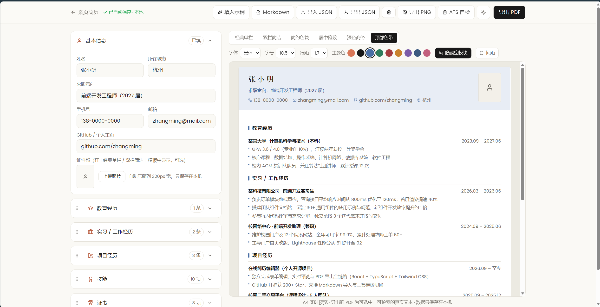

# 素页简历 PlainPage



线上部署手册见 `docs/宝塔部署指南.md`

免费、无水印、ATS 友好的在线简历工具。填写信息 → 选模板 → 导出能通过机器筛选的 PDF。

- **数据不出浏览器** — 无账号、无上传、无埋点，简历只保存在 localStorage，断网可用，随时导出 JSON 备份
- **ATS 友好** — 导出 PDF 为真实文本层（可选中、可检索），单栏阅读顺序，机器初筛不丢内容
- **自由定制** — 6 套模板 × 9 种主题色 × 5 种字体；字号、行距、间距、分栏宽度、区块顺序、证件照、空模块隐藏均可调整

## 本地开发

```bash
npm install
npm run dev      # 开发服务器 http://localhost:5173
npm run build    # 类型检查 + 生产构建
npm run preview  # 预览生产构建
npm run fonts    # 重建 PDF 内嵌字体子集（需先下载源字体，见 scripts/README-fonts.md）
```

## 技术栈

Vite 6 · React 18 · TypeScript · Tailwind CSS v4 · zustand（persist → localStorage）· react-router 7 · @react-pdf/renderer（PDF 导出）· pdf.js（PNG 长图）· lucide-react

界面字体自托管（@fontsource：Poppins / Lora，中文回退系统字体）；PDF 内嵌开源中文字体子集（Noto Sans/Serif SC、霞鹜文楷、朱雀仿宋、资源圆体，均为 OFL 许可，详见 `scripts/README-fonts.md`），全站无外部请求。

## 路线图

- [x] M0 首页与设计系统
- [x] M1 编辑器：本地自动保存 / 实时预览 / JSON 与 Markdown 导入 / 模板与排版定制
- [x] M2 PDF / PNG 导出（真文本 PDF + 同源光栅化长图）
- [x] M3 ATS 自检清单 / 错误边界与空状态 / SEO·GEO / 部署上线（宝塔 + Nginx，Lighthouse 98/100/100/100）
- [ ] M4 移动端真机复检（微信内置浏览器）与发布后打磨

## 协议

暂未确定（计划采用 MIT）。
